<p align="center">
  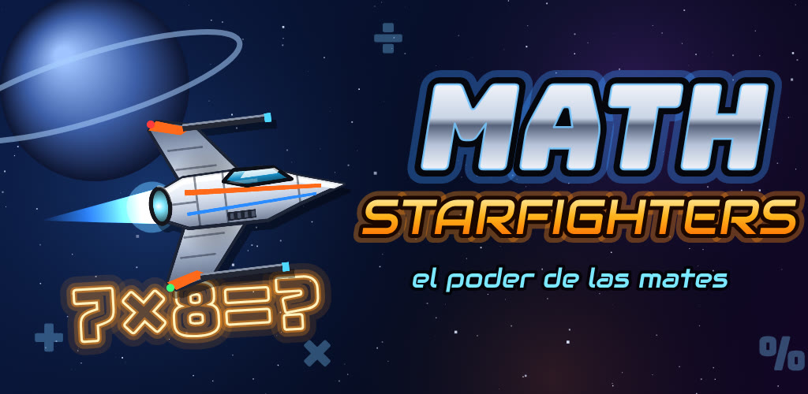
</p>

<h1 align="center">Math Starfighters</h1>

<p align="center">
  <b>Pilota tu nave, resuelve cuentas y salva la galaxia. ¡El poder de las mates!</b><br>
  Juego didáctico para Android: pensar rápido, aprender matemáticas y alimentar las ganas de jugar con las ganas de aprender.
</p>

<p align="center">
  
  
  
  
  
  
</p>

<p align="center">
  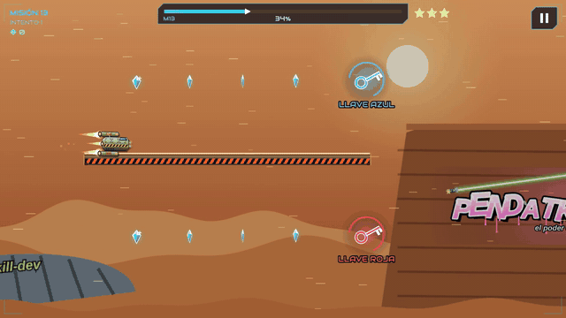
</p>

---

## ¿Qué es?

**Math Starfighters** es un juego de naves de un solo dedo: mantén pulsada la pantalla para subir y suelta para bajar. Esquiva muros, asteroides, láseres y cazas mientras cruzas la galaxia... pero para avanzar no basta con ser rápido: **hay que pensar**.

Está pensado para peques inquietos y muy despiertos (a partir de 6–8 años), a los que les cuesta concentrarse en una ficha de cuentas pero lo dan todo en un reto.

## Características

| | |
|---|---|
| 🧠 **Puertas-pregunta** | Aparece una operación y hay que cruzar el hueco con la respuesta correcta: sumas, restas, tablas, series, doble y mitad, ¿cuál es mayor?, letras que siguen... Cambian en cada intento, así que no vale memorizar. |
| 🔑 **Llaves y puertas de colores** | Coge una llave en un cruce y recuerda su color para elegir el carril correcto más adelante. Planificación y memoria de trabajo. |
| 🪐 **50 misiones en 10 planetas** | Hangar de despegue, espacio profundo, desierto, hielo, luna bosque, lava, ciudad planeta, túnel de la estación, gigante gaseoso y la Estación Oscura. Dificultad progresiva. |
| ⭐ **Recompensas** | 150 estrellas secretas, cristales, rachas, rangos de piloto y 5 naves desbloqueables en el hangar. |
| 💪 **Sin frustración** | Reintento inmediato, mensajes de ánimo, explicación de la respuesta correcta al fallar y modo práctica con puntos de control. |
| ♾️ **Modo infinito** | Se desbloquea tras la misión 10. |
| 🎵 **Todo original** | Música orquestal, naves, escenarios y personajes creados para el juego. |
| 🔒 **Seguro para niños** | Sin anuncios, sin compras, sin cuentas, sin internet y sin recogida de datos. |

## Capturas

| | |
|---|---|
| 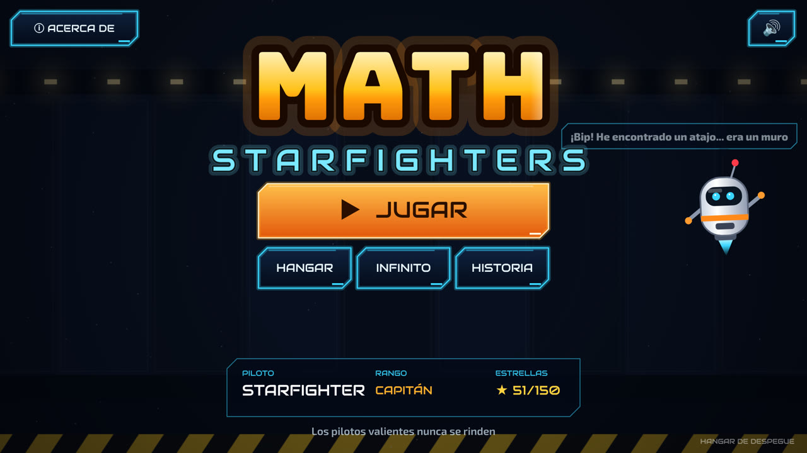 | 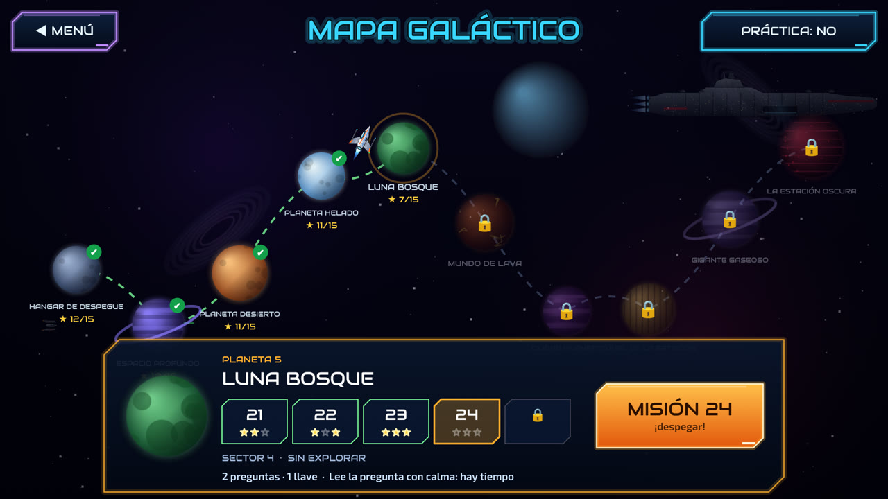 |
| 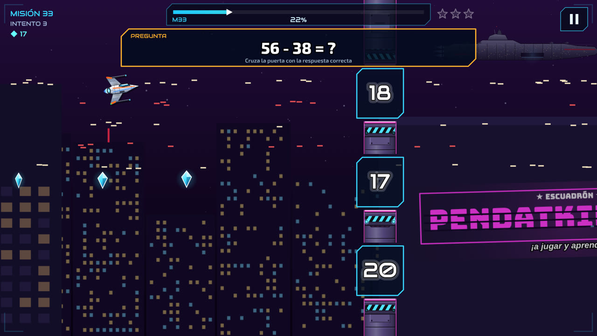 | 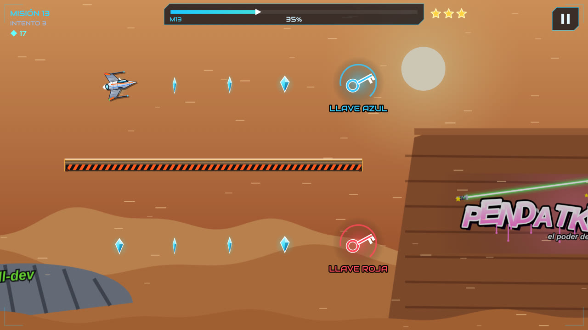 |
| 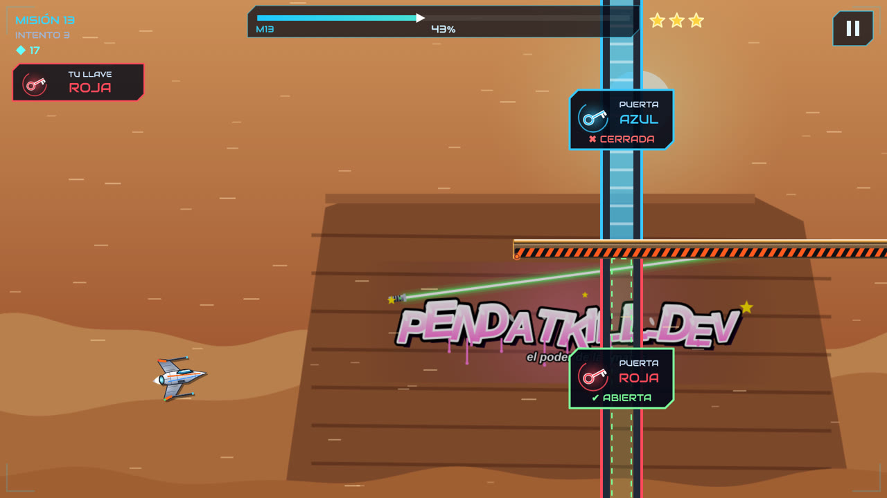 | 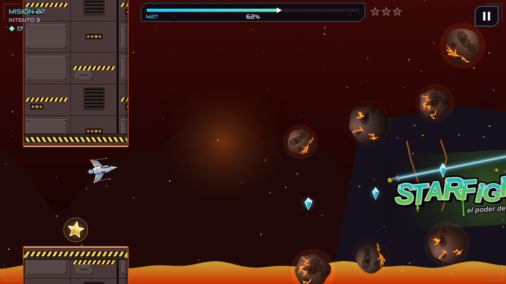 |
| 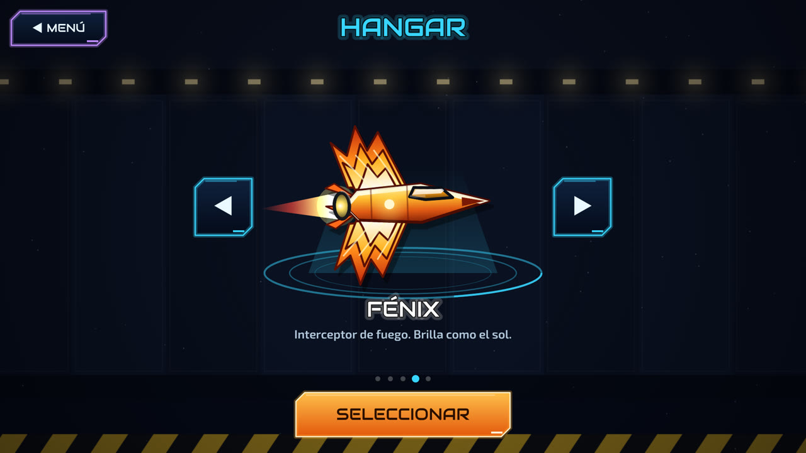 | 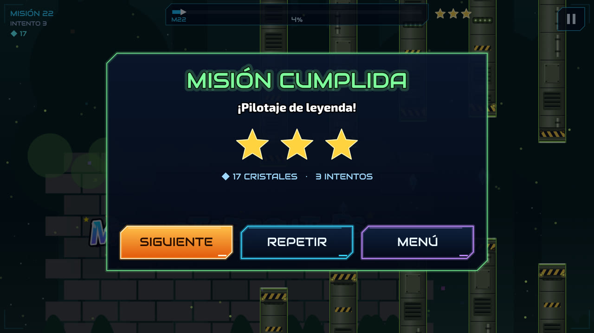 |
| 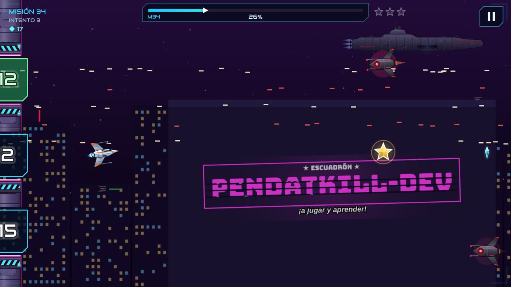 | 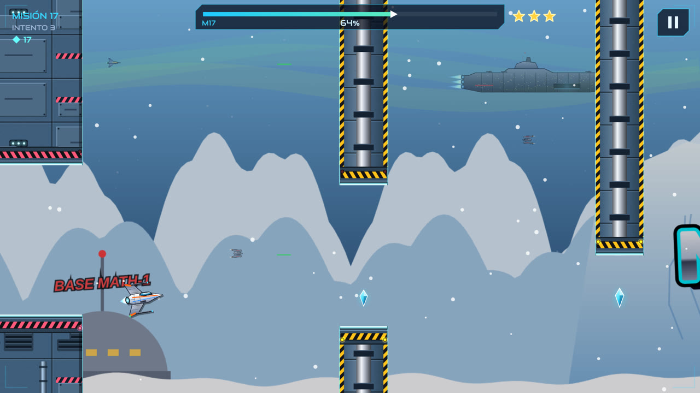 |
| 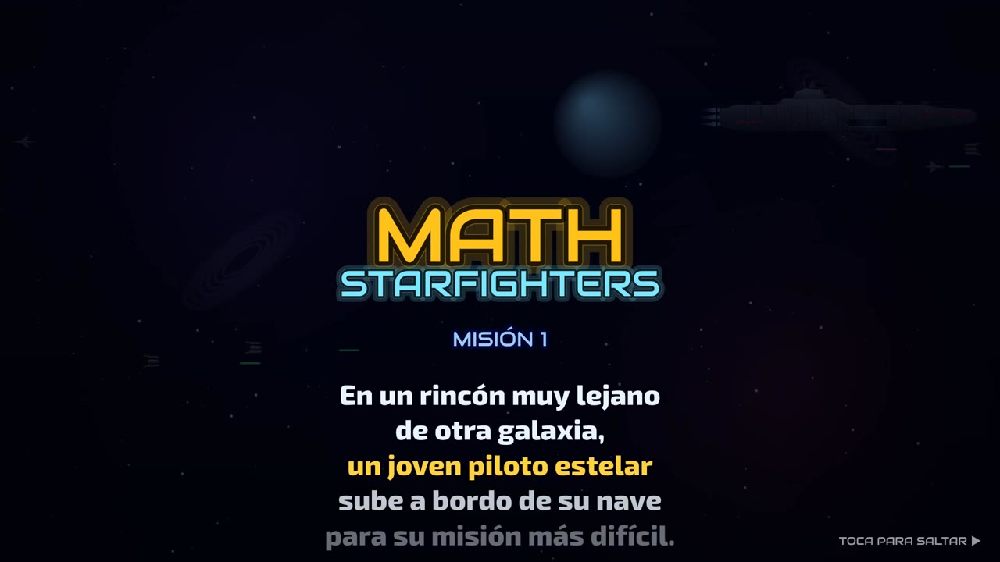 | 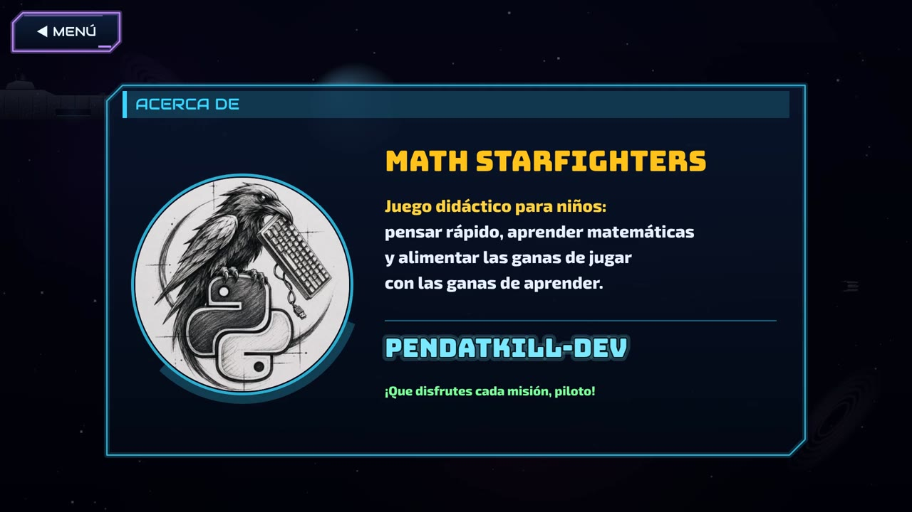 |

## Descargar e instalar

1. Ve a [**Releases**](../../releases/latest) y descarga `MathStarfighters-v1.3.1.apk`.
2. Ábrelo en el móvil. Android pedirá permitir *instalar apps de origen desconocido* para el navegador o el gestor de archivos: acéptalo solo para esta instalación.
3. ¡A jugar!

Puedes comprobar que el archivo no ha sido modificado comparando su huella SHA-256 con la publicada en la release (ver [docs/COMPILAR.md](docs/COMPILAR.md#verificar-la-descarga)).

> Próximamente también en Google Play.

## Cómo se juega

- **Mantén pulsado** → la nave sube. **Suelta** → baja. En el PC: barra espaciadora o clic.
- **Pausa**: botón ⏸ o el botón *atrás* de Android (en el PC, `Esc`).
- Lee la pregunta con calma: el panel aparece con tiempo antes de las puertas.
- Más detalles en [docs/COMO-JUGAR.md](docs/COMO-JUGAR.md).

## Para familias y docentes

- Misiones cortas (de 15 segundos a menos de un minuto), ideales para mantener la atención.
- Las preguntas suben de nivel con los planetas: de sumas sencillas a tablas, series y comparaciones.
- Al fallar se muestra la respuesta correcta y su explicación, para aprender del error.
- No hay chat, ni enlaces externos, ni nada que pida datos al niño.

## Privacidad

La app **no recoge ni comparte ningún dato**. El progreso se guarda solo en el propio dispositivo.
Lee la [política de privacidad completa](docs/PRIVACIDAD.md).

## Compilar desde el código

Requisitos: Android Studio reciente (AGP 8.13, Gradle 8.13, JDK 17) y el SDK de Android 36.

```bash
git clone https://github.com/Pendatkill/android_game-math-starfighters-.git
cd android_game-math-starfighters-
./gradlew assembleDebug        # Windows: gradlew.bat assembleDebug
```

El APK queda en `app/build/outputs/apk/debug/`. Para builds firmados de release y el paquete `.aab` de Google Play, consulta [docs/COMPILAR.md](docs/COMPILAR.md).

### Probar en el navegador

El juego es HTML5: abre `app/src/main/assets/index.html` en Chrome o Edge y juega con la barra espaciadora.

## Estructura del proyecto

```
android_game-math-starfighters-/
├── app/
│   └── src/main/
│       ├── AndroidManifest.xml
│       ├── java/com/pendatkill/mathstarfighters/MainActivity.java   ← WebView a pantalla completa
│       ├── assets/
│       │   ├── index.html   ← juego: niveles, preguntas, interfaz, fondos y lógica
│       │   ├── art.js       ← arte procedural (naves, muros, asteroides, efectos)
│       │   └── audio.js     ← motor de audio + banda sonora original incrustada
│       └── res/             ← icono adaptativo y estilos
├── creditos/                ← licencias de tipografías y soundfont
├── docs/                    ← documentación, privacidad e imágenes
└── build.gradle, settings.gradle, gradlew...
```

Más detalles técnicos en [docs/ARQUITECTURA.md](docs/ARQUITECTURA.md).

## Créditos

- **Diseño, código, arte y niveles:** pendatkill-dev.
- **Música:** composición original, renderizada con el soundfont *GeneralUser GS* de S. Christian Collins ([licencia](creditos/GeneralUser-GS-LICENSE.txt)).
- **Tipografías** (SIL Open Font License 1.1): [Orbitron](creditos/OFL-Orbitron.txt), [Exo 2](creditos/OFL-Exo2.txt), [Audiowide](creditos/OFL-Audiowide.txt) y [Bungee](creditos/OFL-Bungee.txt).

Math Starfighters es un proyecto original e independiente, sin relación con ninguna franquicia de ciencia ficción.

## Licencia

© 2026 pendatkill-dev. Todos los derechos reservados. Consulta [LICENSE](LICENSE).
Las tipografías y el soundfont mantienen sus propias licencias (carpeta [`creditos/`](creditos/)).

---

<p align="center">
  Hecho con ❤️ por <a href="https://github.com/Pendatkill"><b>pendatkill-dev</b></a> · <i>el poder de las mates</i>
</p>
